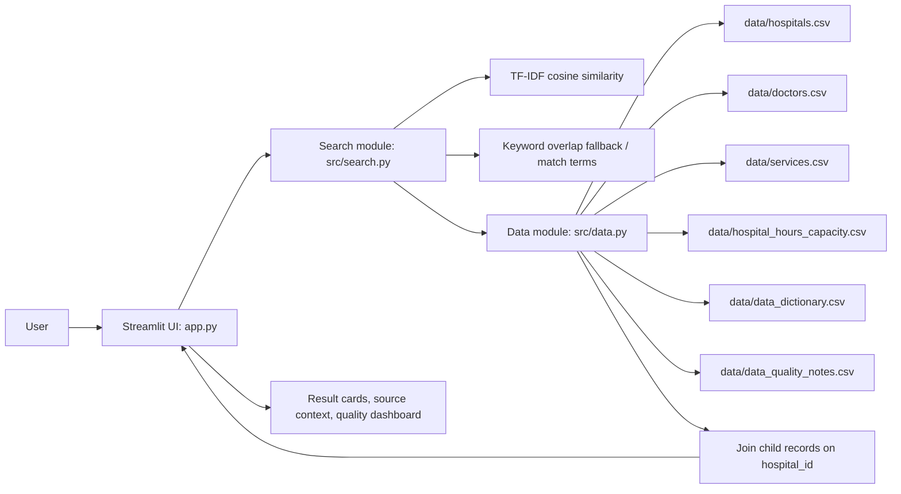

# Architecture and deployment

## Project overview

**Problem:** Healthcare information relevant to a locality is scattered across provider websites, source notes, and transcribed records. Incomplete or stale details can be mistaken for certainty.

**Solution:** A self-contained Streamlit application presents the supplied records in searchable hospital, doctor, and service directories, retaining source context and making uncertainty visible. It is designed for the Kolar, Karnataka demonstration context and the SSF2026 / IBM Z Datathon 2026 project; it does not claim IBM-specific acceleration.

**Community impact:** A shared discovery interface can reduce the effort needed to locate published provider details and specializations. Making missing fields and verification caveats visible can also discourage overconfidence. Benefits depend on maintaining accurate, governed source data.

## Architecture diagram

## Search design

The local search builds a text representation from relevant fields per entity. `TfidfVectorizer` with word unigrams/bigrams and sublinear term frequency computes cosine similarity. A transparent keyword overlap score boosts exact term hits; the search records matched query terms for explainability. A short alias table handles common variants (for example, paediatrician → paediatrics). Search routing infers likely entity type from wording, and users can always use a dedicated entity page. There is no remote model and no network inference call; `scikit-learn` is CPU-friendly and runs locally. Text search is not semantic clinical reasoning and does not assess provider quality.

## LinuxONE deployment

The app is pure Python and uses Pandas, scikit-learn, Plotly and Streamlit. `Dockerfile` starts from the official Python slim image and installs platform-specific wheels during image build. The provided sandbox was not an IBM LinuxONE/s390x environment; the Docker build has not been validated on s390x. On the target Ubuntu 24.04 s390x server, run `docker build --platform linux/s390x -t medifind-ai:latest .` and test whether PyPI has compatible wheels or source builds for pinned/runtime dependency versions. Do not assume this sandbox test proves target compatibility. The app binds inside the container on `0.0.0.0:8501`; use an alternate host port (README example `127.0.0.1:8502`) to avoid JupyterLab conflicts.

No external database, API key, paid model, live availability source, persistent cloud dependency, or Telum feature is implemented.
